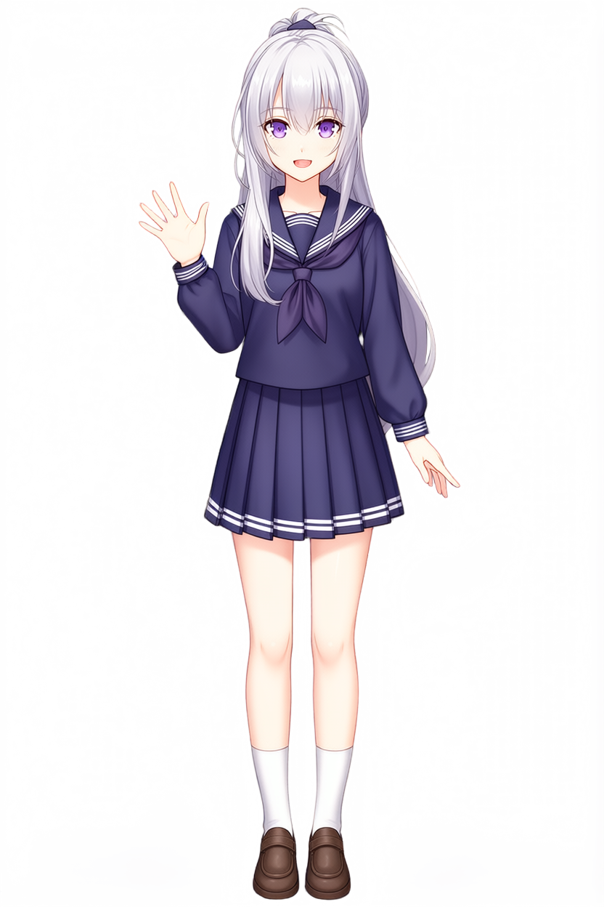

# Primeiro teste — Hugging Face Spaces

Antes de adaptar o workflow para a Modal, Gustavo testou o [Space oficial do Qwen-Image-2.1](https://huggingface.co/spaces/Qwen/Qwen-Image-2.1). Usou as referências RGB simples do [experimento anterior](../../../vn-sprites-agentico/) para gerar um sprite na pose 1, feliz e acenando.

[Baixar esta geração em ZIP](https://raw.githubusercontent.com/Gust4voSSM/criacomp-pieces/main/experiments/vn-qwen-image-21/evidencias/huggingface-spaces-run/huggingface-spaces-run.zip) · [Pedido e limites do registro](prompts.md) · [Proveniência](proveniencia.json)

O arquivo original foi encontrado em Downloads/image.png e copiado sem alteração. O registro de origem do download do Windows aponta para o domínio qwen-qwen-image-2-1.hf.space, confirmando o Space. A imagem tem 832 × 1248 e quatro canais RGBA. O arquivo local tem data de modificação de 21/10/2026; isso não determina por si só o horário da geração.

O PNG não contém metadados textuais. O prompt exato, a seed, os parâmetros e o workflow deste teste não foram recuperados. A descrição do uso das referências RGB e da pose vem do relato do autor.

## Sprite — pose 1

O ZIP inclui o PNG original, este registro, proveniência, prompts.md com as informações disponíveis e SHA256SUMS.txt. Nenhum workflow foi reconstruído para este teste.
