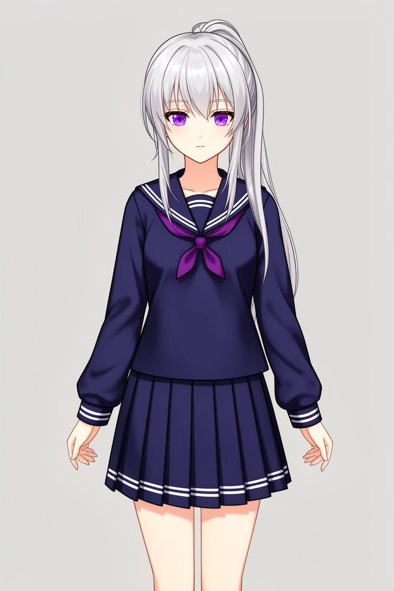
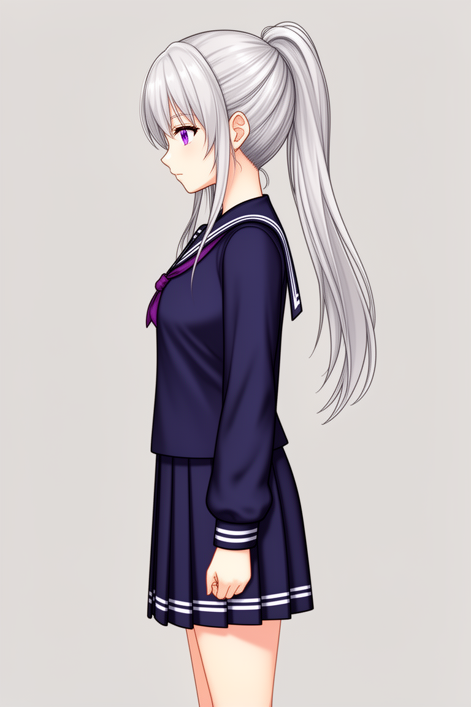
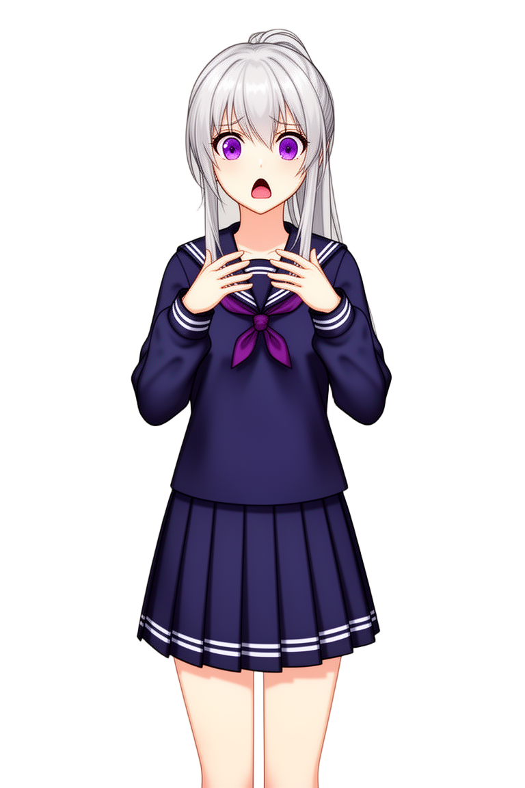
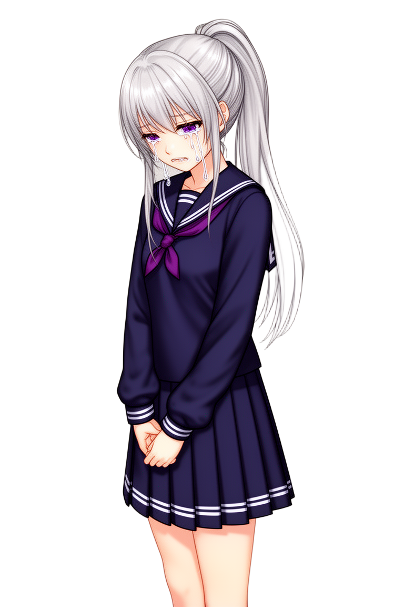

# Personagem de cabelo prateado — workflow inicial

Export: 2026-10-20. Fonte: `comfy-export-2026-10-20-e24e4acd.zip`. A data é a do export, sem presumir a data exata de execução.

[Baixar esta geração em ZIP](https://raw.githubusercontent.com/Gust4voSSM/criacomp-pieces/main/experiments/vn-sprites-agentico/evidencias/primeira-run/primeira-run.zip) · [Prompts](prompts.md) · [Workflow para importar no ComfyUI](workflow.json) · [Proveniência e hashes](proveniencia.json)

Os cinco PNGs foram copiados sem alteração e preservam os metadados originais. Os JSONs ao lado de cada PNG contêm o workflow e o prompt de execução extraídos.

### charsheet_front_00001_

### charsheet_side_00001_

### sprite_pose1_00001_

### sprite_pose2_00001_

### sprite_pose3_00001_

O ZIP contém esta pasta de geração, incluindo `prompts.md`, imagens, workflows e hashes. O próprio ZIP fica fora da compactação.
